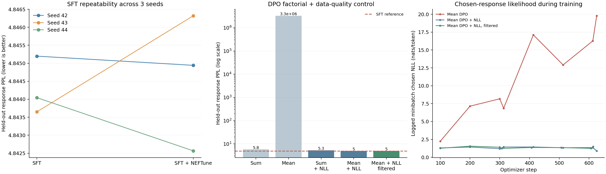

# MiniMind Medical Alignment

基于 [MiniMind](https://github.com/jingyaogong/minimind) 的 **64M 中文医疗问答微调与偏好对齐实验**，围绕嵌入噪声正则化、偏好目标的长度处理和弱偏好数据质量开展对照研究。

[English](README_en.md) · [实验配置](configs/experiments.json) · [完整结果](results/experiments.json) · [数据说明](dataset/dataset.md) · [生成样例](examples/eval_cases_sample.json)

模型为 8 层、hidden size 768，共 **63,912,192 个独立参数**。本项目实现了 SFT、NEFTune、求和／均值 DPO 与 chosen NLL 的可切换训练，以及数据隔离、抽样审阅和统一评测。模型结构、tokenizer 和基础训练框架来自 MiniMind；NEFTune、DPO 均按原论文注明来源。

## 实验设计

| 环节 | 设置 |
| :--- | :--- |
| SFT 对照 | 普通 SFT 与 NEFTune（α=5），随机种子 42、43、44，各训练 2 epochs |
| 偏好目标消融 | 序列 log probability 求和／按回复长度取均值 × chosen NLL 关闭／λ=0.1 |
| 数据质量对照 | 在均值 DPO + NLL 上比较原始偏好数据与过滤后的数据 |
| 数据隔离 | 规范化后的首个用户问题分组，train/val/test 精确交集为 0；DPO 问题仅来自 train |
| 模型选择 | 固定代表种子 42，只按验证集回复 NLL 选择默认模型；其他 SFT 种子用于重复性分析 |
| 最终评测 | 封存的 1,000 个新问题；同时报告全对话与 assistant 回复 PPL |

SFT 使用学习率 5e-5、batch size 32、最大长度 512。全部 DPO 从同一个 NEFTune seed-42 权重开始，使用 β=0.15、学习率 2e-6、batch size 8、2 epochs。四组目标消融共享相同数据和超参数；过滤数据对照单独改变数据。完整设置见 [配置文件](configs/experiments.json)，实际环境见 [环境记录](results/environment.json)。

## 结果



PPL 越低，模型对参考文本的拟合越好；**PPL 不等于医学正确率或安全性**。回复 PPL 仅统计 assistant 回复及其结束标记，按有效 token 汇总；全对话 PPL 还包含问题与模板。所有模型评测相同的 1,000 条样本，共 277,845 个有效全对话 token、208,321 个回复 token，采用 FP32 推理、最大长度 512。

| SFT 方法 | 全对话 PPL，均值 ± 样本标准差 | 回复 PPL，均值 ± 样本标准差 |
| :--- | ---: | ---: |
| 普通 SFT，3 seeds | 8.96153 ± 0.16667 | 4.84430 ± 0.00080 |
| NEFTune，3 seeds | 8.92699 ± 0.10205 | 4.84461 ± 0.00190 |

NEFTune 的平均全对话 PPL 略低，但回复 PPL 的变化很小、方向不一致；这三次实验不足以支持稳定提升的结论。

| 固定 seed-42 对照 | NLL 权重 | 偏好对数 | 全对话 PPL | 回复 PPL |
| :--- | ---: | ---: | ---: | ---: |
| 预训练基座 | — | — | 28.8676 | 21.6621 |
| 普通 SFT | — | — | 9.1521 | 4.8452 |
| NEFTune SFT | — | — | 8.9430 | 4.8449 |
| 求和 DPO | 0 | 2,498 | 10.6655 | 5.7613 |
| 均值 DPO | 0 | 2,498 | 683,028.1613 | 3,304,363.0095 |
| 求和 DPO + NLL | 0.1 | 2,498 | 9.8280 | 5.2950 |
| 均值 DPO + NLL | 0.1 | 2,498 | 9.3796 | 4.9911 |
| 均值 DPO + NLL，过滤数据 | 0.1 | 2,450 | 9.3737 | 4.9908 |

在本轮固定超参数下，均值 DPO 未加 NLL 时出现明显的似然退化，chosen NLL 的训练记录也显示同一现象；加入 NLL 后缓解。过滤数据的变化很小，所有 DPO 的回复 PPL 仍高于 SFT。求和与均值目标的梯度尺度不同，本实验没有分别搜索最优 β 和学习率，因此不能据此判断两类目标各自充分调参后的优劣。

默认推理权重 `medical_model_768.pth` 由验证集选为 **NEFTune SFT，seed 42**；DPO 对照 `medical_dpo_768.pth` 为过滤数据的均值 DPO + NLL。选择记录见 [验证集结果](results/validation.json) 与 [选择依据](results/selection.json)，测试集没有参与选择。

图中的训练曲线来自实际日志中的稀疏 minibatch 统计，不代表整轮平均值；原始数值见 [training_metrics.csv](results/training_metrics.csv)。[20 条生成样例](examples/eval_cases_sample.json) 由固定随机抽样得到，完整保留错误与截断输出，未用于报告胜率。

## 数据与偏好质量

医疗语料来自 [HuatuoGPT-sft-data-v1](https://huggingface.co/datasets/FreedomIntelligence/HuatuoGPT-sft-data-v1)。核心 25,000 条样本经问题分组后，使用 train 22,501 条、val 1,248 条；另从核心语料以外的候选问题中固定抽样 1,000 条作为最终测试集。核心划分中剩余的 1,251 条不进入本次最终评测。实际未混入通用 SFT 数据。

偏好对使用训练集参考答案作 chosen、SFT 采样答案作 rejected，属于**弱标注**。全量规则检查删除 23 条依赖缺失图片的样本；在审阅前按固定种子均匀随机抽取 50 对作模型语义审阅，得到参考答案相对更好 36 对、采样答案相对更好 4 对、不确定 10 对。参考答案存在主要问题、标签反转或无法确定的已审样本予以排除，不翻转标签。规则与抽样审阅合计删除 48 对，保留 2,450 对。

[审阅判断](results/preference_sample_review.json) 和 [过滤摘要](results/preference_quality.json) 可追溯到原始偏好数据 SHA-256。本次没有独立医学专家标签；抽样审阅不能证明其余数据的标签正确，也不构成临床质量认证。检查覆盖规范化后的精确问题重复，尚未排除语义近重复、同一患者不同问法或基座预训练污染。

## 复现

从项目根目录运行。建议 Python 3.10，并安装与 GPU 驱动匹配的 PyTorch；本次实测环境为 RTX 4090 D，具体版本见 [environment.json](results/environment.json)。

```bash
pip install -r requirements-train.txt
```

准备以下输入，数据来源、哈希和文件格式见 [dataset/dataset.md](dataset/dataset.md)：

- 医疗 JSONL：`dataset/raw/FreedomIntelligence/HuatuoGPT-sft-data-v1/HuatuoGPT_sft_data_v1.jsonl`。
- MiniMind 预训练权重：`out/pretrain_768.pth`，来源为 [MiniMind 权重仓库](https://huggingface.co/jingyaogong/minimind-3-pytorch)。本次使用的 SHA-256 已记录，不同权重应作为新的实验。
- tokenizer：仓库内 `model/` 文件。

```bash
# 清洗、问题分组并封存核心语料以外的新测试集；已有数据时跳过
PYTHONPATH=. python scripts/prepare_vertical_data.py --fresh-test-size 1000
PYTHONPATH=. python scripts/check_data_leakage.py

# 3 个种子 × 普通 SFT / NEFTune；同时生成 seed-42 推理别名
PYTHONPATH=. python scripts/run_experiments.py --stage sft

# 仅从 train 采样，构建偏好对并检查隔离
PYTHONPATH=. python scripts/build_onpolicy_dpo.py
PYTHONPATH=. python scripts/check_data_leakage.py --dpo-path dataset/dpo_medical.jsonl

# 重放与原始偏好数据哈希绑定的抽样审阅，并生成过滤数据
PYTHONPATH=. python scripts/audit_preferences.py \
  --semantic-review results/preference_sample_review.json

# 4 组目标消融 + 1 组数据质量对照
PYTHONPATH=. python scripts/run_experiments.py --stage dpo

# 先验证集选择，再统一评测最终测试集
PYTHONPATH=. python scripts/evaluate_experiments.py --phase val
PYTHONPATH=. python scripts/evaluate_experiments.py --phase test
PYTHONPATH=. python scripts/eval_generation.py --num-samples 20
PYTHONPATH=. python scripts/export_results.py

# 生成报告图，可选
pip install -r requirements-report.txt
PYTHONPATH=. python scripts/plot_results.py
```

采样结果可能随硬件、PyTorch 或权重变化。抽样审阅仅适用于其绑定的数据哈希；若脚本提示哈希不符，需要重新审阅当前样本，不能直接套用本次标签。规则过滤可不带 `--semantic-review` 单独执行，但属于另一组数据条件，须单独记录和比较。训练器会记录参数、输入与输出哈希；已经完成的实验只有在参数、数据与权重一致时才会跳过。

数据、完整训练权重和运行日志保存在本地，不随 Git 提交；公开仓库包含配置、结果、摘要、图和固定生成样例。完整上游功能和可选依赖见 [README_upstream.md](README_upstream.md) 与 `requirements.txt`。

```bash
# 使用验证集选定的默认模型
python eval_llm.py --weight medical_model --hidden_size 768 \
  --num_hidden_layers 8 --max_new_tokens 220 --historys 0

# 运行数据隔离、偏好目标、回复掩码与评审完整性检查
PYTHONPATH=. python -m unittest discover -s tests -v
```

如需后续人工 A/B 评审，可运行 `scripts/blind_review.py prepare`，随机化模型顺序后填写全部判断，再运行 `summarize`；脚本检查答案内容、样本完整性和来源记录，分别报告排除平局与平局计半分的统计。

## 核心实现

| 文件 | 职责 |
| :--- | :--- |
| `model/model_minimind.py` | MiniMind 模型与训练态 NEFTune 嵌入噪声 |
| `trainer/train_full_sft.py` | 普通 SFT / NEFTune 开关与训练记录 |
| `trainer/train_dpo.py` | 求和／均值偏好分数、独立 NLL 权重、FP32 log-softmax 与诊断指标 |
| `scripts/data_splits.py` | 问题规范化、分组划分、文件哈希与交集验证 |
| `scripts/build_onpolicy_dpo.py` | 训练集内偏好采样与批量生成 |
| `scripts/audit_preferences.py` | 规则过滤、固定抽样与审阅重放 |
| `scripts/run_experiments.py` | 执行配置中的训练矩阵并记录完成状态 |
| `scripts/evaluate_experiments.py` | 验证集选择、统一测试与多种子汇总 |
| `scripts/eval_ppl.py` | 全对话及 assistant 回复的 token 加权 NLL/PPL |

项目用于微调与对齐研究。生成样例中可见严重医学事实错误，当前结果不支持临床使用，也没有独立人工评测支持“医疗能力提升”或“DPO 胜率提升”的结论。

## 来源与许可

- [MiniMind](https://github.com/jingyaogong/minimind)：模型结构、tokenizer 与基础训练框架；保留 [上游说明](README_upstream.md) 和 [MIT LICENSE](LICENSE)。
- [NEFTune: Noisy Embeddings Improve Instruction Finetuning](https://arxiv.org/abs/2310.05914)。
- [Direct Preference Optimization](https://arxiv.org/abs/2305.18290)。
- [HuatuoGPT](https://github.com/FreedomIntelligence/HuatuoGPT) 及其 [SFT 数据集](https://huggingface.co/datasets/FreedomIntelligence/HuatuoGPT-sft-data-v1)：按数据源许可使用，数据与模型权重的使用条件分别遵循对应来源。
