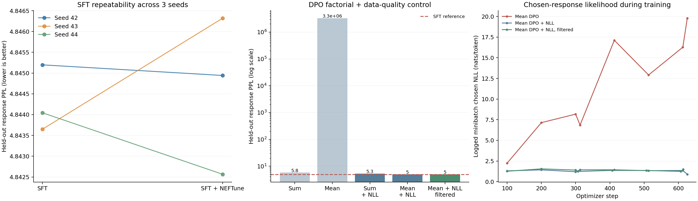

# MiniMind Medical Alignment

**64M-parameter Chinese medical QA fine-tuning and preference-alignment experiments**, built on [MiniMind](https://github.com/jingyaogong/minimind). This repository studies embedding noise, preference-score length aggregation, chosen-response NLL, and weak preference-label quality.

[中文](README.md) · [Configuration](configs/experiments.json) · [Results](results/experiments.json) · [Data](dataset/dataset.md) · [Generation examples](examples/eval_cases_sample.json) · [100-pair anonymous review](examples/answer_review.csv)

The model has 8 layers, hidden size 768, and **63,912,192 unique parameters**. The architecture, tokenizer, and base training framework come from MiniMind. This project adds configurable objectives, split verification, preference auditing, controlled experiments, and evaluation provenance. NEFTune and DPO are credited to their original papers.

## Protocol

| Component | Setting |
| :--- | :--- |
| SFT repeatability | Baseline vs. NEFTune, α=5; seeds 42/43/44; 2 epochs each |
| DPO factorial | Sequence-sum vs. token-mean preference scores × NLL weight 0 vs. 0.1 |
| Data-quality control | Mean DPO + NLL on unfiltered vs. filtered preference pairs |
| Isolation | Normalized first-user-question groups are disjoint across train/val/test; DPO uses train only |
| Selection | Validation response NLL; fixed representative seed 42; other seeds measure repeatability |
| Final evaluation | 1,000 newly held-out questions; full-conversation and response-token PPL |
| Generated-answer assessment | 100 previously unshown test questions; candidates frozen before anonymous A/B model review |

SFT uses learning rate 5e-5, batch size 32, and maximum length 512. All DPO runs start from the same seed-42 NEFTune checkpoint, using β=0.15, learning rate 2e-6, batch size 8, and 2 epochs. The four objective variants share the same data and hyperparameters. The filtered-data control changes only the preference data. See [configuration](configs/experiments.json) and the [actual environment](results/environment.json).

## Results



Lower PPL indicates better likelihood of the reference text, **not medical accuracy or safety**. Response PPL includes assistant responses and their end markers. Full-conversation PPL also includes questions and templates. All runs use the same 1,000 examples, 277,845 full-conversation tokens, and 208,321 response tokens, evaluated in FP32 with maximum length 512.

| SFT method | Full PPL, mean ± sample SD | Response PPL, mean ± sample SD |
| :--- | ---: | ---: |
| Baseline, 3 seeds | 8.96153 ± 0.16667 | 4.84430 ± 0.00080 |
| NEFTune, 3 seeds | 8.92699 ± 0.10205 | 4.84461 ± 0.00190 |

Across the three seeds, NEFTune lowers response PPL in two runs and raises it in one. The table reports the mean and sample standard deviation.

| Seed-42 comparison | NLL weight | Preference pairs | Full PPL | Response PPL |
| :--- | ---: | ---: | ---: | ---: |
| Pretrained | — | — | 28.8676 | 21.6621 |
| Baseline SFT | — | — | 9.1521 | 4.8452 |
| NEFTune SFT | — | — | 8.9430 | 4.8449 |
| Sum DPO | 0 | 2,498 | 10.6655 | 5.7613 |
| Mean DPO | 0 | 2,498 | 683,028.1613 | 3,304,363.0095 |
| Sum DPO + NLL | 0.1 | 2,498 | 9.8280 | 5.2950 |
| Mean DPO + NLL | 0.1 | 2,498 | 9.3796 | 4.9911 |
| Mean DPO + NLL, filtered | 0.1 | 2,450 | 9.3737 | 4.9908 |

On the test set, adding NLL to mean DPO lowers response PPL from 3,304,363.0095 to 4.9911; the filtered-data run scores 4.9908. Every DPO variant in the table has higher response PPL than NEFTune SFT at 4.8449.

Validation selects **seed-42 NEFTune SFT** as `medical_model_768.pth`. The best validation DPO variant, filtered mean DPO + NLL, is available locally as `medical_dpo_768.pth`. See [validation results](results/validation.json) and [selection](results/selection.json). Test scores do not change the selection.

Training curves show sparse logged minibatches rather than epoch averages; values are in [training_metrics.csv](results/training_metrics.csv). The [20 fixed random generation examples](examples/eval_cases_sample.json) retain errors and truncated outputs. They are not used to report a win rate.

### Anonymous A/B review

The comparison uses the validation-selected seed-42 NEFTune SFT and filtered mean DPO + NLL checkpoints. A fixed sample of 100 questions comes from 980 test questions remaining after previously displayed questions are excluded. Sampling and generation seeds are both 73. Both candidates use at most 384 new tokens, temperature 0.7, top-p 0.9, top-k 50, batch size 20, and GPU BF16 inference. A/B positions are balanced. Factuality and safety take priority over relevance and completeness; all judgments are locked before identities are revealed.

| DPO wins | Ties | SFT wins | DPO win rate, excluding ties | Wilson 95% interval | Ties count half |
| ---: | ---: | ---: | ---: | ---: | ---: |
| 27 | 36 | 37 | 42.19% (27/64) | 30.87%–54.39% | 45.00% |

One model reviewer with project context assessed the anonymous answers without reference answers or current per-case model identities. Of 36 ties, 29 have comparable major problems in both answers, 6 have similar quality, and 1 has insufficient evidence. Major-issue flags occur in 70/100 SFT answers and 71/100 DPO answers, including factual errors, fabricated case details, and serious failures to address the question. These are reviewer flags, not clinical accuracy labels; a relative win does not certify a satisfactory answer.

All SFT answers generate EOS; one DPO answer reaches the 384-token limit without EOS and remains in the results. EOS indicates a generated end marker, not semantic completeness. The interval includes 50%: **this review does not provide evidence that DPO improves answer quality over SFT**. The default remains the validation-selected SFT checkpoint.

[All anonymous answers and judgments](examples/answer_review.csv) · [Item-level reasons and revealed identities](results/answer_review_judgments.json) · [Statistics](results/answer_review.json) · [Frozen protocol](results/answer_review_protocol.json) · [Review provenance](results/answer_review_provenance.json)

### DPO training diagnostics

The [diagnostic configuration](configs/dpo_diagnostics.json) fixes the initial SFT checkpoint, data, and hyperparameters across the four objective variants and the filtered-data control. Structured logs contain 20-step window means and epoch summaries. Fixed probes evaluate the same 32 training pairs every 100 steps and at epoch ends, using FP32, eval mode, and fixed empty-think removal.

Diagnostics include policy/reference NLL, token-mean and sequence-sum log-probability changes, reward margins, relative preference ordering, gradient norms before/after clipping and clipping fractions, and teacher-forced conditional token KL. KL is recorded as a diagnostic; the training objective comprises the preference term and the configured chosen NLL term.

| Objective | Probe chosen NLL | Probe rejected NLL | Validation response PPL |
| :--- | ---: | ---: | ---: |
| Initial NEFTune SFT | 1.3572 | 1.0918 | 4.6800 |
| Sum DPO | 1.5412 | 1.5774 | 5.5625 |
| Mean DPO | 16.5532 | 23.5017 | 2,459,034.5898 |
| Sum DPO + NLL | 1.4263 | 1.4089 | 5.1041 |
| Mean DPO + NLL | 1.3231 | 1.2233 | 4.8059 |
| Mean DPO + NLL, filtered | 1.3259 | 1.2162 | 4.8047 |

Probe NLL averages per-sequence response-token means on the fixed training pairs. Validation PPL uses the same 300 validation examples with response-token weighting. All five runs record zero prompt/mask/EOS violations and nonfinite losses. Final chosen-context token KL is 11.9253 for mean DPO and 0.0456 for mean DPO + NLL.

[Diagnostics and parameter comparison](results/dpo_diagnostics.json) · [Window/probe metrics](results/dpo_diagnostic_metrics.csv) · [Diagnostic curves](images/dpo_diagnostics.png)


## Data and preference quality

The source is [HuatuoGPT-sft-data-v1](https://huggingface.co/datasets/FreedomIntelligence/HuatuoGPT-sft-data-v1). From 25,000 core medical examples, question-group splitting provides 22,501 training and 1,248 validation examples. A separate fixed sample of 1,000 questions outside the entire core corpus forms the final test set. The remaining 1,251 core examples are excluded from final evaluation. No general-domain SFT data was mixed in this run.

Training reference answers are designated chosen and SFT generations rejected: these are **weak labels**. Rules remove 23 pairs requiring unavailable images. A uniform random sample of 50 pairs, fixed before inspection, receives model semantic review: 36 favor the reference, 4 the sampled response, and 10 are uncertain. Reviewed pairs with uncertain/reversed preferences or major reference problems are removed without label flipping. Rules and sampled review remove 48 pairs in total, retaining 2,450.

[Item-level judgments](results/preference_sample_review.json) and the [quality summary](results/preference_quality.json) record the review decisions and counts.

## Reproduction

Run from the repository root, preferably with Python 3.10 and a GPU-compatible PyTorch installation.

```bash
pip install -r requirements-train.txt
```

Prepare the medical JSONL at `dataset/raw/FreedomIntelligence/HuatuoGPT-sft-data-v1/HuatuoGPT_sft_data_v1.jsonl`, and MiniMind pretrained weights at `out/pretrain_768.pth`. The tokenizer is included under `model/`. See [data preparation](dataset/dataset.md), [upstream weights](https://huggingface.co/jingyaogong/minimind-3-pytorch), and the [environment record](results/environment.json).

```bash
PYTHONPATH=. python scripts/prepare_vertical_data.py --fresh-test-size 1000
PYTHONPATH=. python scripts/check_data_leakage.py
PYTHONPATH=. python scripts/run_experiments.py --stage sft
PYTHONPATH=. python scripts/build_onpolicy_dpo.py
PYTHONPATH=. python scripts/check_data_leakage.py --dpo-path dataset/dpo_medical.jsonl
PYTHONPATH=. python scripts/audit_preferences.py \
  --semantic-review results/preference_sample_review.json
PYTHONPATH=. python scripts/run_experiments.py --stage dpo
PYTHONPATH=. python scripts/evaluate_experiments.py --phase val
PYTHONPATH=. python scripts/evaluate_experiments.py --phase test
PYTHONPATH=. python scripts/eval_generation.py --num-samples 20
PYTHONPATH=. python scripts/export_results.py

# Optional report figure
pip install -r requirements-report.txt
PYTHONPATH=. python scripts/plot_results.py

# Validation-selected model
python eval_llm.py --weight medical_model --hidden_size 768 \
  --num_hidden_layers 8 --max_new_tokens 220 --historys 0

# Integrity and objective checks
PYTHONPATH=. python -m unittest discover -s tests -v

# Full-forward, cached-forward, and greedy-generation checks on SFT / DPO weights
PYTHONPATH=. python scripts/check_kv_cache.py --device cpu --dtype float32

# Run the fixed DPO diagnostic matrix and render its traces
PYTHONPATH=. python scripts/run_dpo_diagnostics.py
PYTHONPATH=. python scripts/plot_dpo_diagnostics.py
```

KV Cache tests cover tokenwise and chunked continuation, left-padded batches, cache reuse, and greedy generation, including cache length and content checks. Actual-checkpoint CPU FP32 checks use `atol=1e-4` and `rtol=1e-5`; results are recorded in [kv_cache_consistency.json](results/kv_cache_consistency.json).

The diagnostic configuration binds to the recorded inputs. Update its input fingerprints when using different data or initial weights.

Skip data preparation when the verified split already exists. Scripts automatically check data, checkpoint, and review-record consistency. A data/review mismatch requires a new review. Running the audit without `--semantic-review` applies rules alone and is recorded as a separate data condition. Completed experiments are reused when their settings, data, and checkpoints match.

Full datasets, trained weights, and logs remain local and are excluded from Git. The repository publishes configurations, results, summaries, figures, and fixed generation examples. Base features and optional dependencies are documented in [README_upstream.md](README_upstream.md) and `requirements.txt`.

The completed model review uses the workflow below. Generation does not score answers automatically: inspect only the anonymous form and save item-level judgments in `out/answer_blind_review/judgments/batch_*.json`, using the fields in the published judgments. After every pair is judged, `lock` records content fingerprints; `publish` verifies them before reading identities. Changed questions or answers require a new review.

```bash
# Skip generation if this review already exists; finish all anonymous judgments before locking.
PYTHONPATH=. python scripts/prepare_answer_review.py
PYTHONPATH=. python scripts/finalize_answer_review.py lock
PYTHONPATH=. python scripts/finalize_answer_review.py publish
```

For a separate human review, `scripts/blind_review.py` provides generic `prepare` / `summarize` commands with separate reviewer provenance.

This is a fine-tuning and alignment research project. Clinical validation has not been performed.

## Attribution and license

- [MiniMind](https://github.com/jingyaogong/minimind): architecture, tokenizer, and training framework; [upstream documentation](README_upstream.md) and [MIT license](LICENSE) retained.
- [NEFTune: Noisy Embeddings Improve Instruction Finetuning](https://arxiv.org/abs/2310.05914).
- [Direct Preference Optimization](https://arxiv.org/abs/2305.18290).
- [HuatuoGPT](https://github.com/FreedomIntelligence/HuatuoGPT) and its [SFT dataset](https://huggingface.co/datasets/FreedomIntelligence/HuatuoGPT-sft-data-v1). Data and pretrained weights follow their respective source terms.
